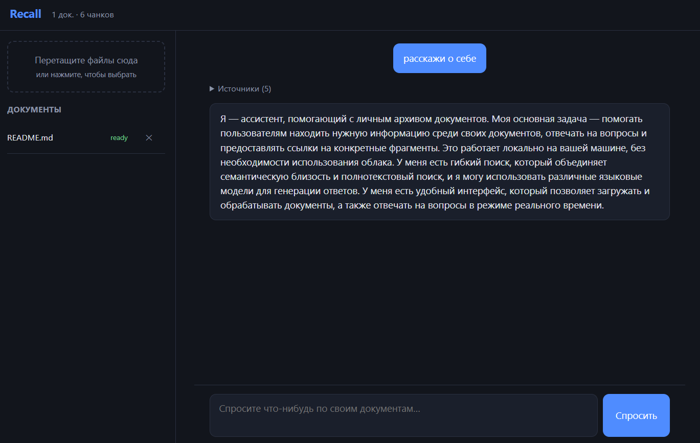

# Recall

## Описание

Локальный «второй мозг»: RAG-поиск и чат по вашим документам.
Загружаете текстовые файлы — задаёте вопросы — получаете ответы **со ссылками
на конкретные фрагменты** ваших документов. Всё работает на вашей машине,
ничего не уходит в облако.

## Как это работает

Recall — классический RAG (Retrieval-Augmented Generation) на локальных моделях:

1. **Ingest**: файл читается, нормализуется и режется на перекрывающиеся чанки.
2. **Embedding**: каждый чанк превращается в вектор (модель `nomic-embed-text`)
   и сохраняется в SQLite вместе с полнотекстовым индексом FTS5.
3. **Retrieval**: вопрос тоже превращается в вектор; гибридный поиск
   комбинирует семантическую близость (косинусное сходство) и полнотекстовый
   поиск (bm25) через Reciprocal Rank Fusion.
4. **Generation**: найденные фрагменты собираются в промпт, и локальная
   chat-модель (`qwen2.5:7b` через Ollama) отвечает строго по ним —
   с цитатами [N]. Ответ стримится в браузер по SSE токен за токеном.

Против галлюцинаций работает grounding: модель обязана отвечать только
на основе найденных фрагментов, а пользователь всегда видит источники.

## Возможности

- 🗂 Загрузка документов drag-and-drop: `.txt`, `.md`, `.html`, код, конфиги
- ⚡ Параллельный ingest-пайплайн: очередь с backpressure, пул воркеров,
  батчевые эмбеддинги, живой статус обработки каждого файла
- 🔍 Гибридный поиск: FTS5 + векторный поиск, слияние через RRF
- 💬 Чат со стримингом (SSE) и кнопкой «Стоп» (отмена через context)
- 📎 Цитаты-источники: документ, номер фрагмента, оценка релевантности
- 🧩 Сменные провайдеры LLM: Ollama или любой OpenAI-совместимый API
  (одна переменная окружения)
- 📦 Весь интерфейс встроен в бинарник через `//go:embed` — один exe,
  ноль зависимостей
- 🛑 Graceful shutdown: Ctrl+C аккуратно останавливает сервер, конвейер
  и базу в правильном порядке

## Технологии

- **Go 1.27** — весь стек: HTTP API, worker pool, SSE, статика
- **Конкурентность**: горутины, каналы, `sync.WaitGroup`, `context.Context`,
  `sync/atomic` (счётчики без мьютексов)
- **SQLite** (modernc.org/sqlite — без CGO) + FTS5; векторы хранятся
  в BLOB, косинусная близость считается в Go
- **Gin** — HTTP-фреймворк
- **Ollama** — локальный рантайм моделей
- **Docker** — многоступенчатая сборка, non-root, healthcheck

## Установка

> Нужен [Ollama](https://ollama.com) с двумя моделями:
> `ollama pull nomic-embed-text && ollama pull qwen2.5:7b`
(первая для обработки текста, вторую можете использовать подходящую под ваше железо)

### Вариант 1 — готовый бинарник

Скачайте архив для своей платформы со страницы
[Releases](https://github.com/WOLFraMix/recall/releases/latest),
распакуйте и запустите:

    ./recall            # Linux/macOS
    .\recall.exe        # Windows

### Вариант 2 — Docker

    docker pull ghcr.io/wolframix/recall:latest
    docker run -d -p 8080:8080 \
      -e RC_LLM_URL=http://host.docker.internal:11434 \
      -v ${PWD}/data:/app/data \
      --add-host host.docker.internal:host-gateway \
      ghcr.io/wolframix/recall

### Вариант 3 — из исходников

    git clone https://github.com/WOLFraMix/recall
    cd recall
    go build ./cmd/recall

## v1.1.0

- **PDF и DOCX**: загрузка бинарных форматов с честными ошибками (сканы без текстового слоя не принимаются).
- **Вкладка «Поиск»**: прямой доступ к гибридному ретриверу — видны фрагменты и их релевантность до генерации ответа.
- **Гибридный поиск исправлен**: починен FTS-канал (contentless FTS5 не хранит unindexed-колонки — джойн теперь по rowid), добавлен псевдо-стемминг для русской морфологии, RRF взвешен (точное совпадение весомее семантики).
- **.env**: конфигурация через файл (`.env.example` в репозитории), дефолты в коде согласованы с ним.
- **Модель эмбеддингов по умолчанию — bge-m3**: мультиязычная, корректно работает с русским (nomic-embed-text подтверждённо путал семантику русских фраз — см. `cmd/embedcheck`).
- **Инструменты диагностики**: `cmd/embedcheck` (качество эмбеддера на вашем языке) и `cmd/ftscheck` (целостность FTS-индекса).
- **Промпт**: модель обязана признавать, когда ответа во фрагментах нет, вместо придумывания «главного».
